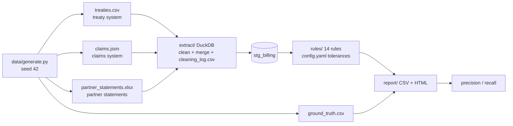

# Reinsurance Billing Validation Lab

A validation system for **synthetic** reinsurance billing data. It merges three source systems, cleans the data with DuckDB, runs 14 validation rules and measures detection quality against a ground-truth list of injected defects.



## Run

```bash
pip install -r requirements.txt
python -m data.generate && python -m extract.extract && python -m report.run && python -m rules.docs
pytest --cov
```

## Results (measured)

| Metric | Value |
|---|---|
| Validation rules | 14 |
| Statement lines | 245 (20 treaties, 8 partners, 369 claims) |
| Injected defects (8 types x 5) | 40 |
| Defects found | 40 (recall 1.0) |
| False positives | 0 (precision 1.0) |
| Validation runtime | 0.044 s (CI, Ubuntu) |
| Tests | 58 passed |
| Coverage | 98.86 % (gate 90 %) |


## Rules

See [docs/rules](docs/rules/README.md), generated from the rule docstrings (`python -m rules.docs`).

## Honest notes

- **All data is synthetic**, created by a seeded random generator. No real insurer, cedent, treaty or claim data is used.
- The defects are injected by the same project that detects them, so 100 % recall shows the rules work on these known patterns, not that they would catch every real-world issue.
- Amounts, rates and partner IDs are invented and carry no business meaning.
